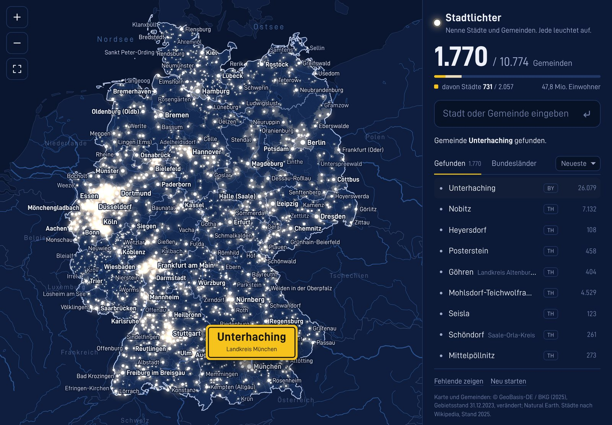

# Stadtlichter

**Deutschland bei Nacht: Nenne alle 10.774 Städte und Gemeinden. Jeder Ort, den du findest, leuchtet auf der Karte auf.**



**Spielen:** https://tungtungtunglarpsahur.github.io/deutschland/

## So geht's

- Rechts eine Stadt oder Gemeinde eintippen und Enter drücken. Oben steht, wie viele der 10.774 Gemeinden du schon hast, darunter wie viele der 2.057 Städte davon.
- Jeder Ort zählt genau einmal. Gibt es mehrere mit demselben Namen (17-mal Neustadt, elfmal Neuenkirchen, viermal Halle …), bekommst du sie nacheinander, den größten zuerst. Du kannst den Zusatz auch gleich mitschreiben: „Frankfurt (Oder)“, „Halle Westfalen“, „Aschau am Inn“.
- Die Schreibweise ist egal: groß oder klein, ä oder ae, „St.“ oder „Sankt“, amtliche Abkürzungen wie „i.OB“ oder ausgeschrieben, mit oder ohne Klammern und Bindestriche. „Garmisch“ reicht für Garmisch-Partenkirchen.
- Ortsteile zählen nicht (Schwabing, Westerland). Bei Tippfehlern kommt ein Vorschlag.
- Gefundene Orte leuchten weiß: Städte als helle Lichter, Gemeinden als kleinere. Ihr Gebiet wird hell, und beim Fund steht kurz das Ortsschild auf der Karte.
- Unter der Eingabe stehen alle gefundenen Orte, sortierbar nach Neueste, A–Z oder Größe. Antippen fliegt hin.
- „Bundesländer“ zeigt den Fortschritt je Land, jeweils mit den Städten. „Fehlende zeigen“ deckt die übrigen Orte rot auf.
- Der Spielstand bleibt im Browser gespeichert. Spielstände aus der reinen Städte-Version gelten weiter.

## Auf dem iPad

- Läuft in Safari quer (Eingabe rechts) und hochkant (Eingabe unten), mit Pinch-Zoom, Ziehen und Doppeltippen.
- Teilen → „Zum Home-Bildschirm“ macht daraus eine Vollbild-App, die auch offline läuft.

## Die Karte

Staatsgrenze, Bundesländer, alle 400 Kreise und alle Gemeindegrenzen (beim Hineinzoomen deutlicher), dazu Flüsse, Seen und die Nachbarländer. Gezeichnet mit Canvas in einer Lambert-Projektion, ohne Kartendienst und ohne Bibliotheken.

## Lokal starten

Kein Build nötig, nur ein kleiner Webserver (die Daten werden per `fetch` geladen):

```sh
python3 -m http.server 8000
```

Dann http://localhost:8000 öffnen.

## Veröffentlichen mit GitHub Pages

Settings → Pages → „Deploy from a branch“ → Branch `main`, Ordner `/ (root)`.

## Daten und Quellen

| Inhalt | Quelle | Lizenz |
| --- | --- | --- |
| Gemeinden, Grenzen und Einwohner (Gebietsstand 31.12.2023: 10.775 Gemeinden einschließlich der bewohnten gemeindefreien Bezirke Lohheide und Osterheide) | VG250-EW, © GeoBasis-DE / BKG (2025), bezogen über [dimfalk/vg250](https://github.com/dimfalk/vg250), vereinfacht und projiziert | [Datenlizenz Deutschland – Namensnennung 2.0](https://www.govdata.de/dl-de/by-2-0) |
| Städteliste | [pensnarik/german-cities](https://github.com/pensnarik/german-cities) (Wikipedia, 2021), ergänzt um Tamm (2022), Oberderdingen (2023), die Fusion Berga-Wünschendorf (2024) und Haar (2025); abgeglichen mit der [Liste der Städte in Deutschland](https://de.wikipedia.org/wiki/Liste_der_St%C3%A4dte_in_Deutschland) (2.057 Städte, Stand Januar 2025) | CC0 |
| Kreisfreie Städte | [landkreise-deutschland](https://github.com/mojoaxel/landkreise-deutschland), nach Destatis GV-ISys | CC BY 4.0 |
| Nachbarländer, Flüsse, Seen | [Natural Earth](https://www.naturalearthdata.com) | gemeinfrei |
| Schrift | D-DIN-PRO, auf Basis von D-DIN (Datto) | SIL Open Font License 1.1, siehe `fonts/OFL.txt` |

Berga/Elster und Wünschendorf/Elster sind schon zur Stadt Berga-Wünschendorf (2024) zusammengelegt, deshalb zählt das Spiel 10.774 Orte. Andere Gemeindefusionen seit 2024 stecken noch nicht in den Daten, weil die BKG-Grenzen mit neuerem Gebietsstand hier nicht abrufbar waren; `tools/data/build.sh` holt beim nächsten Lauf den dann aktuellen Stand.

`tools/data/build.sh` baut die Dateien in `data/` aus diesen Quellen neu. `tools/make_icons.py` erzeugt die App-Icons.

## Aufbau

| Datei | Aufgabe |
| --- | --- |
| `index.html`, `css/app.css` | Oberfläche |
| `js/app.js` | Spielstand, Eingabe, Liste, Ortsschild, Infokarte |
| `js/map.js` | Kartendarstellung mit Zoom, Pinch, Schwung und Lichtern |
| `js/match.js` | Schreibweisen vergleichen, Namensvetter, Tippfehler |
| `js/geo.js` | Kartendaten dekodieren |
| `sw.js`, `manifest.webmanifest` | Offline-Betrieb und Installation als App |
| `data/` | Karte mit allen Gemeindeflächen (2,2 MB), Ortsliste mit 10.774 Städten und Gemeinden |

## Lizenz

Code: MIT, siehe `LICENSE`. Für Daten und Schrift gelten die Lizenzen in der Tabelle oben.
